# Project_template

Это шаблон для решения проектной работы. Структура этого файла повторяет структуру заданий. Заполняйте его по мере работы над решением.

# Задание 1. Анализ и планирование

### 1. Описание функциональности монолитного приложения

**Границы анализа.** As-Is описывает действующую систему: 100 веб-клиентов и 100 модулей управления отоплением. Исходники в [apps/smart_home](apps/smart_home) — учебная реализация работы с датчиками, которая подтверждает только часть этого описания. Ниже явно разделены сведения из условия, наблюдения по коду и предлагаемые границы будущих контекстов.

**Управление отоплением:**

- Пользователь удалённо включает и выключает отопление в своём доме через веб-интерфейс.
- Сервер отправляет команду модулю управления отоплением синхронно. Инициатор взаимодействия с оборудованием — сервер.
- Первичная установка и подключение требуют выезда специалиста. Самостоятельного подключения оборудования пользователем в текущей системе нет.
- Регулирование заданной температуры и автоматические сценарии в условии As-Is не описаны; их наличие не предполагается.

**Мониторинг температуры:**

- Пользователь просматривает текущую температуру в доме через веб-интерфейс.
- Сервер запрашивает показания у датчика и ожидает ответ. Самостоятельная отправка показаний датчиком и событийная обработка в As-Is отсутствуют.
- В учебном коде получение одного датчика и списка датчиков сопровождается синхронными HTTP-запросами к внешнему API температуры. Для списка датчики опрашиваются последовательно.
- История измерений и графики в текущем решении не подтверждены: таблица `sensors` содержит значение и время обновления, но отдельной таблицы истории нет. Новые показания при чтении подставляются в HTTP-ответ без сохранения в БД.

**Что дополнительно есть в учебном коде:** создание, получение, изменение и удаление записей датчиков, ручное обновление значения и статуса, получение температуры по расположению. Создание записи датчика через API не равно безопасному подключению физического устройства пользователем. Код управления отоплением, веб-интерфейс и процедура установки оборудования в репозитории отсутствуют; функциональность отопления принимается из условия.

### 2. Анализ архитектуры монолитного приложения

| Аспект | As-Is и подтверждение |
| --- | --- |
| Приложение | Монолит на Go. В учебном коде используется Gin; обработчики, обращение к API температуры и доступ к данным собираются в одно приложение ([main.go](apps/smart_home/main.go), [go.mod](apps/smart_home/go.mod)). Разделение по пакетам не создаёт независимых сервисов. |
| Данные | PostgreSQL. В учебном коде доступ через `pgxpool`, общая таблица `sensors` ([db.go](apps/smart_home/db/db.go), [init.sql](apps/smart_home/init.sql)). Модели домов и пользователей в этой схеме отсутствуют. |
| Пользовательский доступ | По условию — веб-интерфейс. В репозитории предоставлен HTTP API `/api/v1/sensors`; реализация самого интерфейса не предоставлена. |
| Взаимодействие с оборудованием | По условию сервер синхронно управляет отоплением и запрашивает температуру у датчиков. Конкретный протокол реального оборудования не задан. В учебном коде вызовы температуры выполняются по HTTP с JSON-ответом и тайм-аутом клиента 10 секунд ([temperature_service.go](apps/smart_home/services/temperature_service.go)). |
| Обработка запросов | Вызовы БД и API температуры выполняются в цепочке обработки пользовательского запроса. В `GetSensors` опрос оборудования идёт последовательно ([sensors.go](apps/smart_home/handlers/sensors.go)). При этом Go HTTP-сервер допускает конкурентную обработку разных запросов: из синхронного взаимодействия не следует однопоточность всего приложения. |
| Асинхронное взаимодействие | По условию отсутствует. В учебной бизнес-логике нет очередей сообщений, событийных потребителей и фонового сбора температуры. Горутина запуска HTTP-сервера в `main.go` не является асинхронным обменом между системами. |
| Развёртывание | По условию обновление требует остановки всего приложения. В репозитории есть [Dockerfile](apps/smart_home/Dockerfile); конфигурация [Compose](apps/docker-compose.yml) оставлена незавершённой для задания 5. Механизм обновления без простоя не представлен. Сам по себе монолит не исключает такого механизма. |
| Масштабирование | Единица развёртывания и масштабирования — всё приложение. Увеличить мощности только опроса температуры или управления отоплением независимо нельзя без изменения границ приложения. Фактические пределы производительности нагрузочными измерениями не установлены. |

**Сильные стороны текущего решения.** Для исходного масштаба монолит даёт простое развёртывание одного приложения, небольшое число инфраструктурных зависимостей и локальные транзакции в одной БД. Команде из пяти разработчиков проще сопровождать такую систему, чем сразу большой набор распределённых сервисов. Поэтому необходимость изменения архитектуры связана с новыми функциями, самообслуживанием и независимым развитием частей системы, а не с самим числом в 100 клиентов.

### 3. Определение доменов и границы контекстов

**Предметная область** — удалённое управление умным домом. В As-Is она охватывает отопление и наблюдение за температурой; в To-Be расширяется до нескольких видов оборудования и пользовательских сценариев.

**Термины единого языка:**

- **Дом** — объект, к которому относятся оборудование и права пользователя.
- **Устройство** — физический датчик или исполнительный прибор. Датчик измеряет, исполнительный прибор меняет физическое состояние.
- **Модуль** — выбираемый пользователем функциональный комплект для определённой задачи, например отопления; может включать несколько устройств. Модуль и отдельное устройство не считаются синонимами.
- **Команда** — запрос изменить состояние прибора. Команда и подтверждённое состояние прибора — разные понятия.
- **Измерение** — значение датчика с единицей измерения и временем получения показания.
- **Сценарий** — пользовательское правило: условие и набор действий над модулями.

#### As-Is: существующие области ответственности

В текущем монолите нет подтверждённых изолированных bounded contexts. Ниже приведены логические границы, выделенные анализом предметной области, а не уже существующие сервисы.

| Поддомен → кандидат в ограниченный контекст | Ответственность и принадлежащие ему понятия | Граница |
| --- | --- | --- |
| Управление отоплением → «Отопление» | Включение и выключение отопления; команда, состояние отопления, модуль управления. Функция описана в условии, но не реализована в учебном API. | Решает, какое действие требуется для отопления. Не отвечает за регистрацию оборудования и хранение показаний температуры. |
| Мониторинг температуры → «Телеметрия» | Запрос показаний и предоставление текущей температуры; измерение, единица, время показания. В коде — вызовы `TemperatureService` и подстановка результата в ответ. | Предоставляет наблюдаемые значения. Не выдаёт команды включения отопления и не считает запись в БД доказательством доступности устройства. |
| Учёт и подключение оборудования → «Устройства» | Идентификация, тип, расположение, параметры подключения и жизненный цикл оборудования. В As-Is подключением занимается специалист; учебный код содержит CRUD записей `Sensor`. | Определяет, какое оборудование подключено и как его адресовать. Бизнес-правила отопления и содержание измерений принадлежат другим контекстам. |

Сейчас эти ответственности связаны одним приложением и моделью данных. Например, `Sensor` одновременно хранит идентификационные атрибуты (`id`, `type`, `location`) и последнее значение (`value`, `unit`, `last_updated`). Это точка будущего разделения модели, а не основание автоматически выделять сервис на каждую таблицу.

#### To-Be: необходимые расширения предметной области

Границы ниже нужны для последующей декомпозиции в задании 2; способы развёртывания и взаимодействия здесь ещё не проектируются.

| Поддомен → кандидат в ограниченный контекст | Ответственность и собственная модель | Развитие относительно As-Is |
| --- | --- | --- |
| Управление устройствами → «Устройства и модули» | Каталог совместимых типов и комплектов, привязка устройства к дому, проверка права подключения, регистрация и отключение; устройство, тип, модуль, возможности устройства. | Развитие учёта оборудования до самообслуживания. Не владеет бизнес-правилами конкретных приборов. |
| Управление отоплением → «Отопление» | Команды отоплению, допустимые режимы и подтверждённое состояние отопительного оборудования. | Сохраняет текущий сценарий включения/выключения; модель может развиваться независимо от других приборов. |
| Управление освещением → «Освещение» | Включение/выключение света и состояние осветительных приборов. | Новая функциональность; не содержит правила управления воротами или отоплением. |
| Управление воротами → «Ворота» | Открытие/закрытие и запирание/отпирание в пределах возможностей оборудования, допустимые переходы состояния. | Новая функциональность с собственными правилами исполнения команд. |
| Удалённое наблюдение → «Видеонаблюдение» | Камера и авторизованный доступ к просмотру видеопотока. | Новая функциональность; видеопоток не смешивается с числовыми измерениями температуры. Хранение видеоархива условием не требуется. |
| Сбор и просмотр показаний → «Телеметрия» | Приём, хранение и чтение измерений разных типов; измерение, временной ряд, качество и актуальность данных. | Развитие мониторинга температуры для других датчиков. Не владеет каталогом устройств и управляющими командами. |
| Пользовательская автоматизация → «Сценарии» | Создание и исполнение правил «условие → действия»; сценарий, условие, действие. | Новая функциональность. Использует показания и запрашивает действия у соответствующих контекстов; не обращается напрямую к оборудованию. |
| Пользовательский доступ → «Пользователи и дома» | Учёт пользователя и дома, проверка доступа пользователя к ресурсам дома. | Необходимая для SaaS граница; её реализация в As-Is не предоставлена. Не отвечает за физические протоколы устройств. |
| Подключение партнёрского оборудования → «Интеграция с устройствами» | Адаптеры протоколов и преобразование команд, ответов и показаний; соединение, адрес, возможности протокола. | Выделяет технические различия устройств из бизнес-правил. Поддержка нового протокола может потребовать нового адаптера. |

Отопление, освещение, ворота, наблюдение и сценарии относятся к основному поддомену продукта. Учёт устройств, телеметрия и интеграция поддерживают его; управление учётными записями и доступом — общий поддомен, где можно использовать готовое решение.

**Применение DDD и связи контекстов:**

- «Пользователи и дома» определяет принадлежность ресурсов и права пользователя. «Устройства и модули» определяет идентичность оборудования, его привязку к дому и поддерживаемые возможности.
- Функциональные контексты используют идентификатор устройства и его возможности, но каждый владеет своими командами и правилами. Одинаковое слово «состояние» имеет разные модели: температура измеряется, свет включается, ворота открываются и запираются.
- «Интеграция с устройствами» выступает защитным слоем (Anti-Corruption Layer): переводит внутренние операции в протокол оборудования и преобразует ответы. Формат конкретного производителя не становится общей доменной моделью.
- «Телеметрия» поставляет измерения «Сценариям»; «Сценарии» инициируют действия в функциональных контекстах. Отправка команды не считается подтверждением изменения состояния физического прибора.
- При выделении контекстов их модели и данные получают явного владельца. Другая область использует контракт владельца, а не изменяет его таблицы напрямую.

Ограниченный контекст не обязательно равен отдельному микросервису. Для команды из пяти разработчиков сначала следует закрепить границы ответственности и контрактов, а независимое развёртывание обосновать в задании 2. Для нового типа устройства потребуется описание его возможностей; новый протокол потребует адаптера, а принципиально новая бизнес-функция — развития соответствующего контекста или нового контекста. Обещание поддержать любое неизвестное оборудование без изменений кода не принимается.

### 4. Проблемы монолитного решения

| Проблема и основание | Последствие для бизнеса или эксплуатации |
| --- | --- |
| Каждое подключение требует выезда специалиста; самостоятельное подключение отсутствует (условие). | Рост числа домов увеличивает объём ручной работы и время подключения. Переход к SaaS требует изменения самого процесса подключения, а не только разделения приложения. В половине желающих подключиться домов оборудование ещё необходимо установить. |
| Функциональность ограничена отоплением и температурой (условие). | Освещение, ворота, наблюдение и сценарии нельзя предложить на текущей функциональной модели. Их разработка внутри одного приложения увеличивает объём связанных изменений и регрессионного тестирования. |
| Опрос оборудования выполняется синхронно; в `GetSensors` — ещё и последовательно (код). | Время ответа списка растёт вместе с суммой задержек датчиков. При недоступности N датчиков ожидание внешних вызовов может составить порядка `N × 10 секунд`, без учёта БД и прочих накладных расходов. Это оценка по коду, а не результат нагрузочного теста. |
| В учебном коде ошибка получения температуры только журналируется; возвращается значение из БД со старым статусом и временем (код). | Успешный HTTP-ответ не гарантирует свежесть температуры. Пользователь не получает явный признак неудачного обновления и может принять сохранённое значение за актуальное. |
| Последнее значение хранится вместе с записью датчика; отдельной истории нет (код). | Нельзя получить историю измерений из существующей схемы. Развитие телеметрии требует собственной модели хранения и правил актуальности. |
| Функции поставляются и масштабируются одним приложением (условие и структура кода). | Нельзя независимо обновить или масштабировать обработку показаний. Сбой процесса затрагивает доступность всех функций; конкретные пределы нагрузки требуют измерений. |
| Текущий процесс обновления останавливает приложение (условие). | Изменение одной функции прерывает доступ ко всему решению. Нужен отдельный план изменения процесса поставки; микросервисы сами по себе не обеспечат обновления без простоя. |
| В учебной модели есть только тип `temperature`; универсальный контракт возможностей и адаптеры партнёрских протоколов не представлены (код). | Расширение набора устройств потребует изменений модели и интеграции. Без выделенной границы протокольные особенности будут распространяться в бизнес-логику. |
| В учебном API нет моделей пользователей и домов и проверки доступа к датчикам (код). | Представленный API недостаточен для самообслуживания нескольких независимых клиентов SaaS. Наличие и устройство соответствующих механизмов в действующей системе из условия неизвестны. |

**Приоритеты дальнейшего планирования:** сохранить работоспособность управления отоплением и мониторинга; определить владение домами и устройствами и процесс самостоятельного подключения; закрепить контракты работы с оборудованием; затем спроектировать независимое развитие функциональных контекстов и телеметрии. Новые приборы, сценарии и механизм перехода к целевой системе детализируются в следующих заданиях.

### 5. Визуализация контекста системы — диаграмма C4

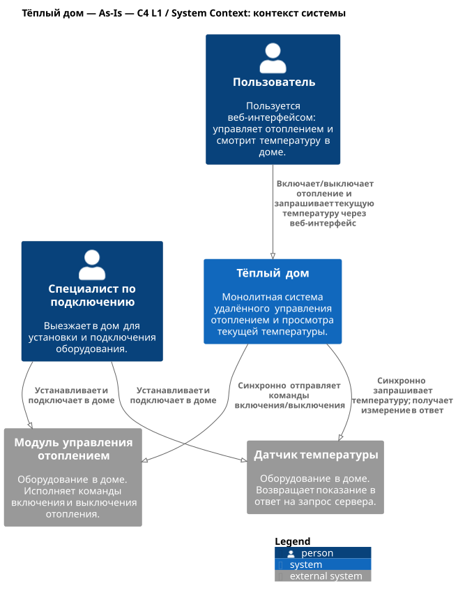

[Исходник PlantUML](docs/diagrams/as-is/c4-l1-system-context.puml) · [Открыть SVG](docs/diagrams/as-is/c4-l1-system-context.svg)

Диаграмма уровня **System Context (C4 L1)** отражает As-Is из условия. В её центре — вся программная система «Тёплый дом». Пользователь обращается к ней через веб-интерфейс; система сама инициирует команды модулю отопления и запросы к датчику температуры. Ответ с измерением возвращается в рамках этого синхронного запроса, а не отдельным событием. Специалист показан в роли установщика оборудования; отдельный административный интерфейс для него не предполагается.

Модуль отопления и датчик показаны как внешние по отношению к программной системе устройства. Это функциональные роли: условие не уточняет, находятся ли они в одном корпусе. PostgreSQL, пакеты Go и веб-интерфейс являются внутренними деталями решения и на уровне L1 отдельно не раскрываются. Учебный `temperature-api` представляет оборудование в задании 5 и не добавляется в контекст действующей системы как микросервис.

SVG уже включён в репозиторий и доступен без установки инструментов. Для повторной генерации нужен PlantUML с библиотекой C4 в стандартной поставке. Используется встроенный движок Smetana; загрузка включений из интернета и установка Graphviz не нужны.

Все диаграммы **As-Is и To-Be** рендерятся одним скриптом. Из корня репозитория выполните:

```bash
python3 tools/render_diagrams.py
```

Скрипт рекурсивно обрабатывает все `.puml` в `docs/diagrams/` и сохраняет SVG рядом с исходниками, включая `docs/diagrams/as-is/c4-l1-system-context.svg`. Параметры настройки описаны в разделе «Просмотр и повторная генерация» ниже.

# Задание 2. Проектирование микросервисной архитектуры

Диаграммы описывают проектируемую To-Be систему на основе контекстов задания 1. Это архитектурный проект; реализация учебного монолита находится в `apps/smart_home`. Целевой стек разрабатываемых микросервисов — **Java 21 и Spring Framework**: Spring MVC и Spring Security для HTTP API, Spring JDBC и транзакции для PostgreSQL, Spring AMQP для RabbitMQ, Spring Integration для MQTT.

### Диаграммы контейнеров (C4 L2)

Четыре представления одной модели разделяют пользовательские запросы, асинхронный обмен, владение данными и передачу видео. Все связи и ограничения указаны на диаграммах.

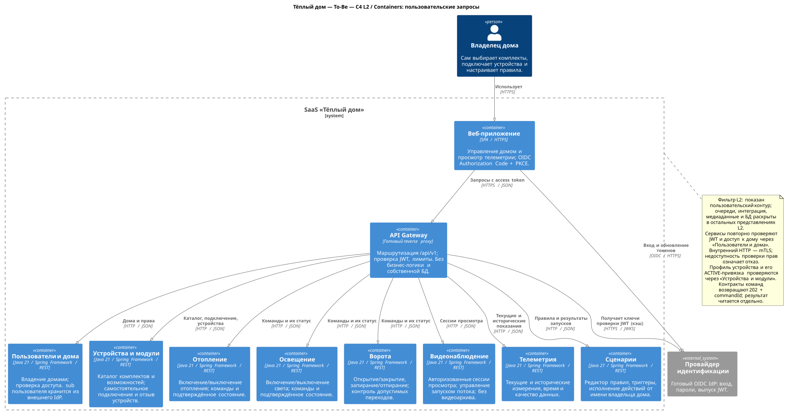

[Открыть SVG](docs/diagrams/to-be/c4-l2-containers-api.svg) · [Исходник PlantUML](docs/diagrams/to-be/c4-l2-containers-api.puml)

<details>
<summary>C4 L2 / Containers — Команды, события и устройства</summary>

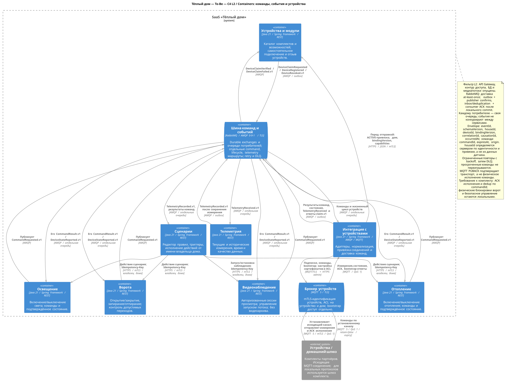

[Открыть SVG](docs/diagrams/to-be/c4-l2-containers-events.svg) · [Исходник PlantUML](docs/diagrams/to-be/c4-l2-containers-events.puml)

</details>

<details>
<summary>C4 L2 / Containers — Владение данными: отдельная БД и роль каждого сервиса</summary>

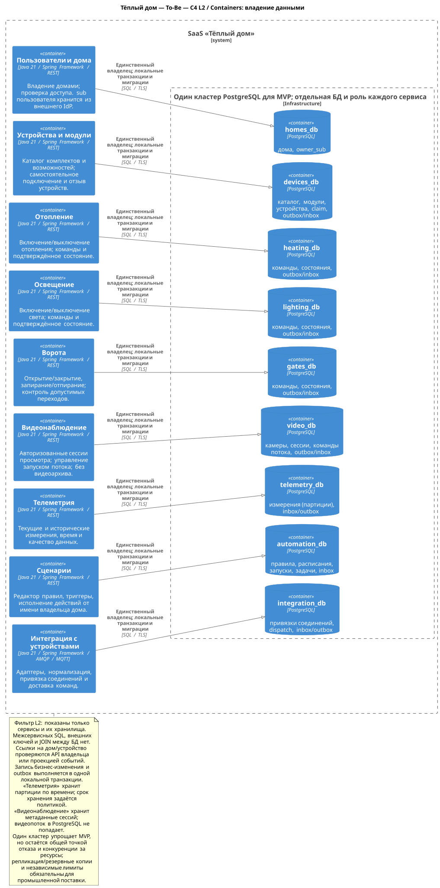

[Открыть SVG](docs/diagrams/to-be/c4-l2-containers-data.svg) · [Исходник PlantUML](docs/diagrams/to-be/c4-l2-containers-data.puml)

</details>

<details>
<summary>C4 L2 / Containers — Видеонаблюдение: управление сессией и отдельный медиатракт</summary>

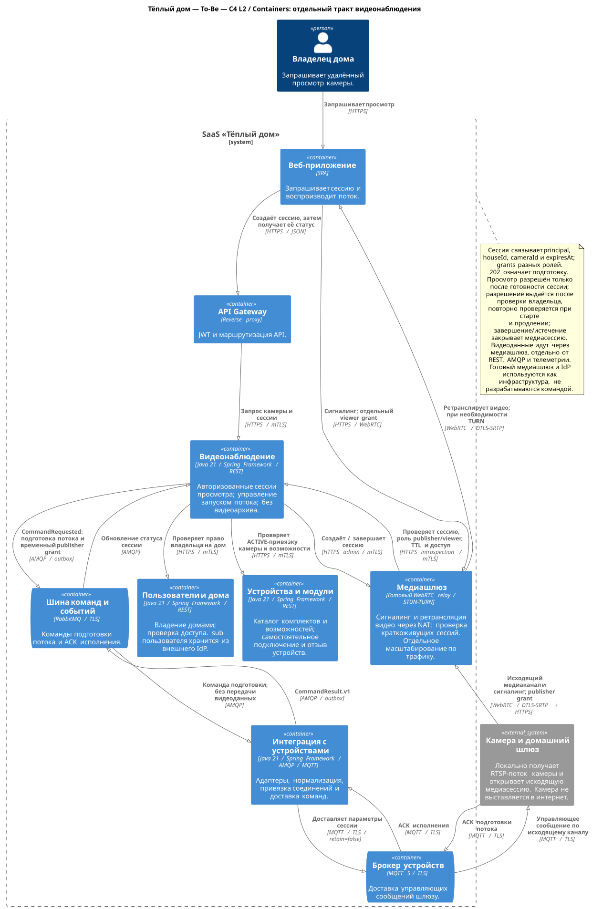

[Открыть SVG](docs/diagrams/to-be/c4-l2-containers-video.svg) · [Исходник PlantUML](docs/diagrams/to-be/c4-l2-containers-video.puml)

</details>

### Диаграммы компонентов (C4 L3)

Показан каждый из девяти разрабатываемых микросервисов. API Gateway, брокеры, внешний IdP и медиашлюз — готовая инфраструктура; веб-приложение — клиент. Их внутренняя реализация не декомпозируется.

<details>
<summary>C4 L3 / Components — Пользователи и дома</summary>

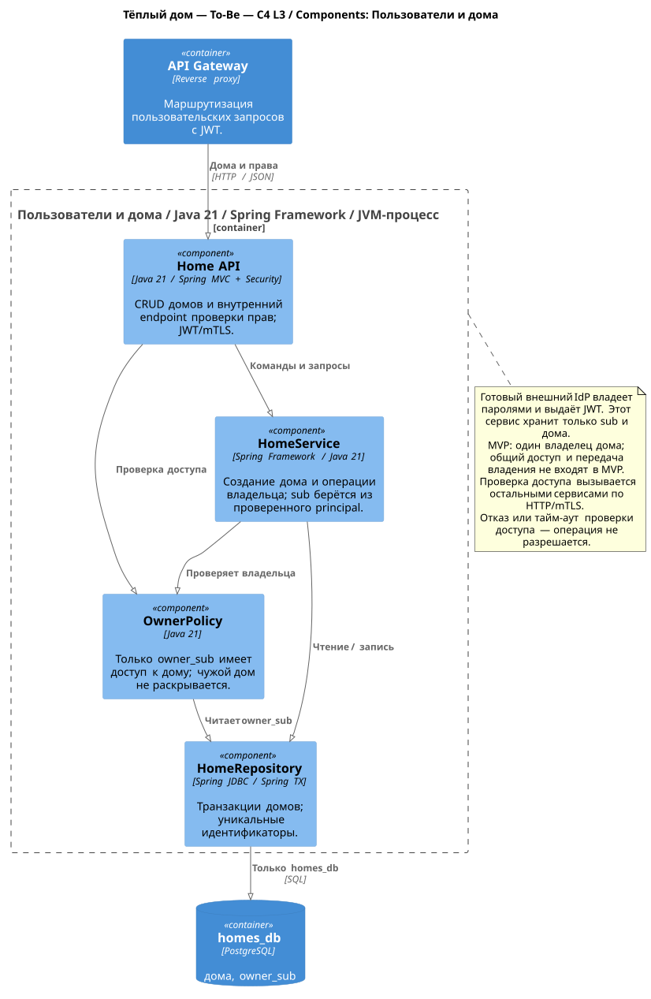

[Открыть SVG](docs/diagrams/to-be/c4-l3-components-homes.svg) · [Исходник PlantUML](docs/diagrams/to-be/c4-l3-components-homes.puml)

</details>

<details>
<summary>C4 L3 / Components — Устройства и модули</summary>

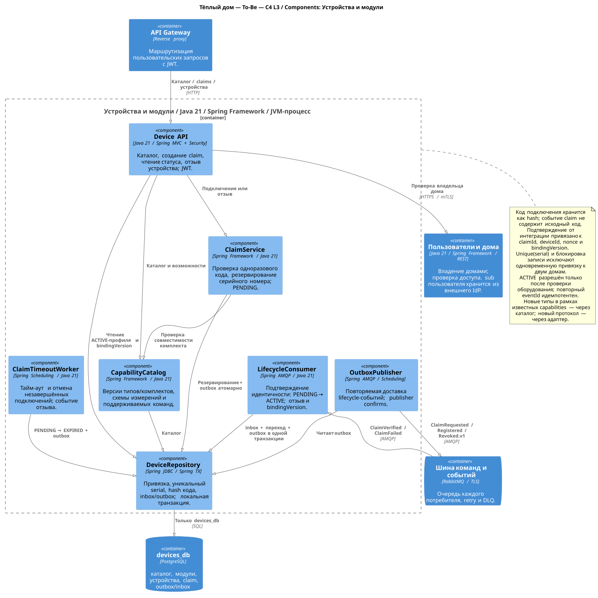

[Открыть SVG](docs/diagrams/to-be/c4-l3-components-devices.svg) · [Исходник PlantUML](docs/diagrams/to-be/c4-l3-components-devices.puml)

</details>

<details>
<summary>C4 L3 / Components — Отопление</summary>

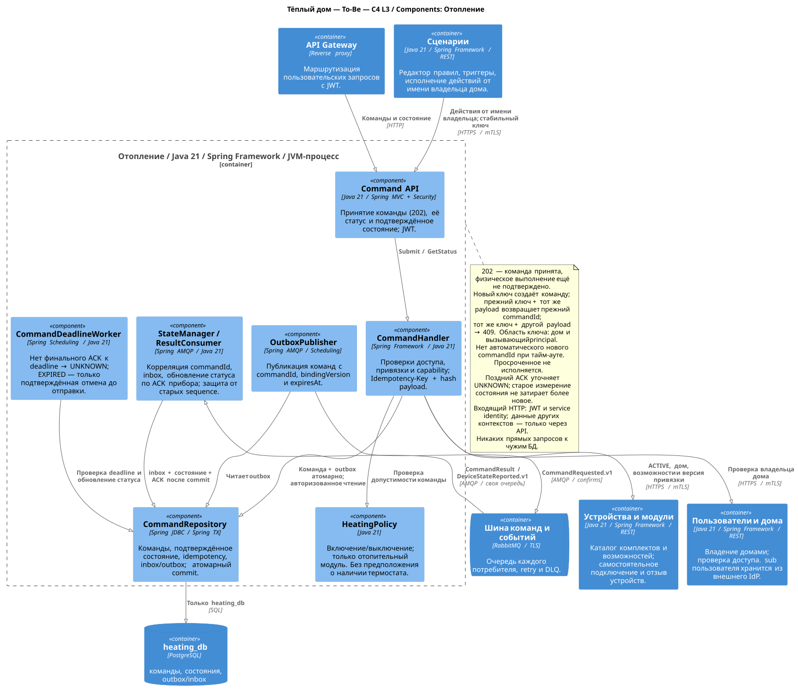

[Открыть SVG](docs/diagrams/to-be/c4-l3-components-heating.svg) · [Исходник PlantUML](docs/diagrams/to-be/c4-l3-components-heating.puml)

</details>

<details>
<summary>C4 L3 / Components — Освещение</summary>

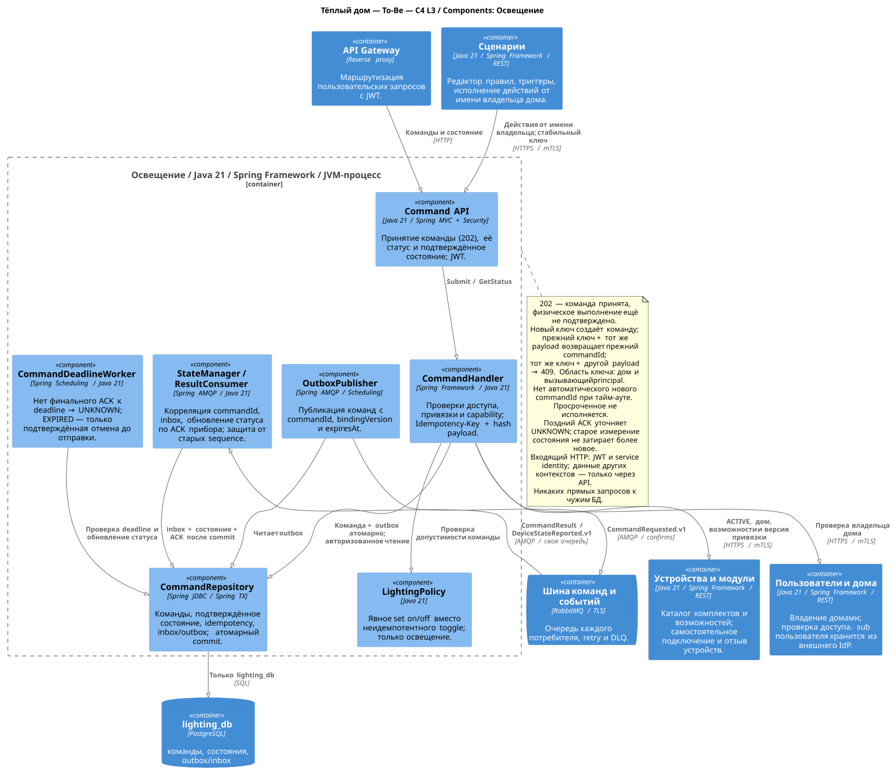

[Открыть SVG](docs/diagrams/to-be/c4-l3-components-lighting.svg) · [Исходник PlantUML](docs/diagrams/to-be/c4-l3-components-lighting.puml)

</details>

<details>
<summary>C4 L3 / Components — Ворота</summary>


[Открыть SVG](docs/diagrams/to-be/c4-l3-components-gates.svg) · [Исходник PlantUML](docs/diagrams/to-be/c4-l3-components-gates.puml)

</details>

<details>
<summary>C4 L3 / Components — Видеонаблюдение</summary>

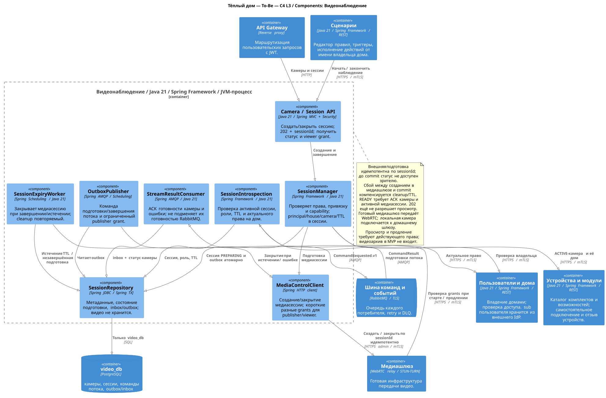

[Открыть SVG](docs/diagrams/to-be/c4-l3-components-video.svg) · [Исходник PlantUML](docs/diagrams/to-be/c4-l3-components-video.puml)

</details>

<details>
<summary>C4 L3 / Components — Телеметрия</summary>

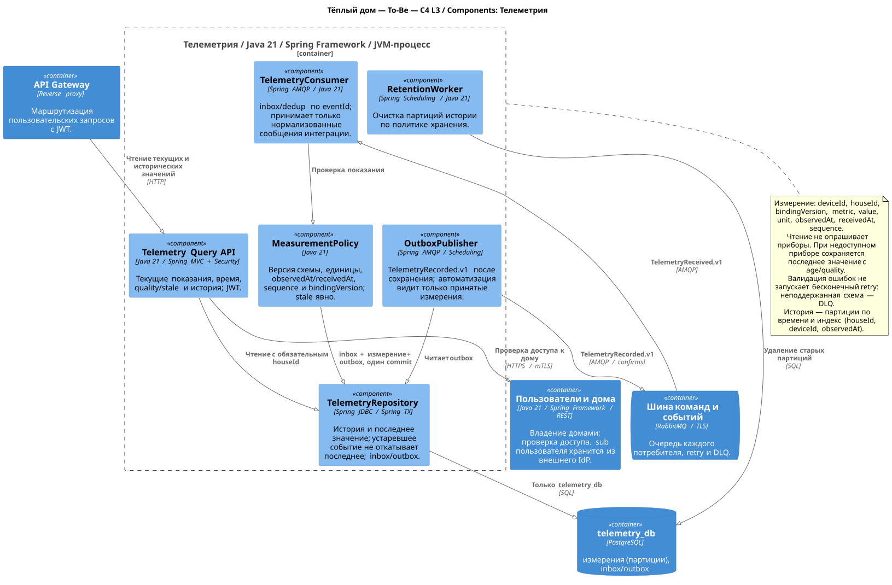

[Открыть SVG](docs/diagrams/to-be/c4-l3-components-telemetry.svg) · [Исходник PlantUML](docs/diagrams/to-be/c4-l3-components-telemetry.puml)

</details>

<details>
<summary>C4 L3 / Components — Сценарии</summary>

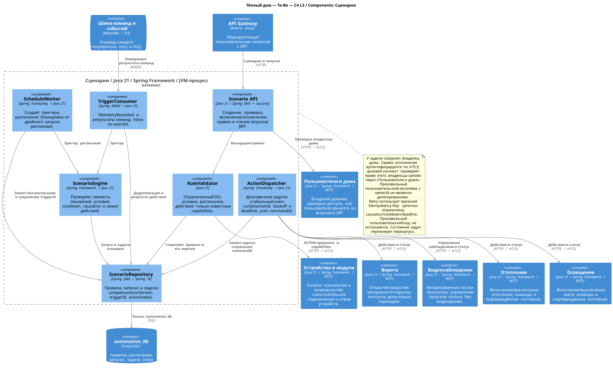

[Открыть SVG](docs/diagrams/to-be/c4-l3-components-automation.svg) · [Исходник PlantUML](docs/diagrams/to-be/c4-l3-components-automation.puml)

</details>

<details>
<summary>C4 L3 / Components — Интеграция с устройствами</summary>

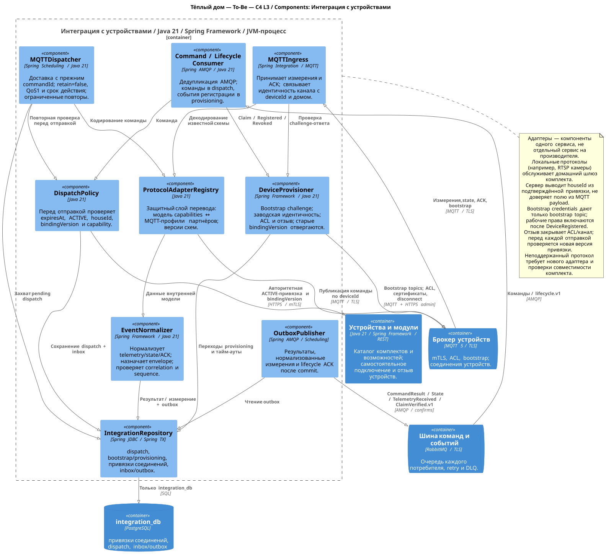

[Открыть SVG](docs/diagrams/to-be/c4-l3-components-integration.svg) · [Исходник PlantUML](docs/diagrams/to-be/c4-l3-components-integration.puml)

</details>

### Уровень кода (C4 L4)

Проектная UML-модель детализирует компонент `CommandHandler` функциональных сервисов на Java 21 и Spring Framework.

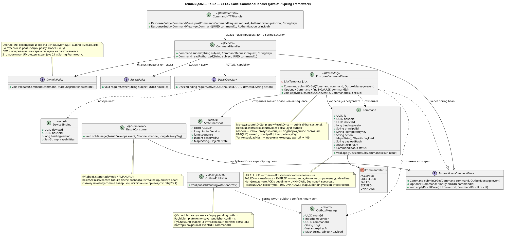

[Открыть SVG](docs/diagrams/to-be/c4-l4-code-command-model.svg) · [Исходник PlantUML](docs/diagrams/to-be/c4-l4-code-command-model.puml)

### Динамические диаграммы уровня компонентов (C4 L3)

Последовательности показывают взаимодействие компонентов и внешних для них контейнеров при доставке команды и подключении комплекта.

<details>
<summary>C4 L3 / Dynamic — последовательность: доставка команды, повторы, ACK исполнения и тайм-аут</summary>

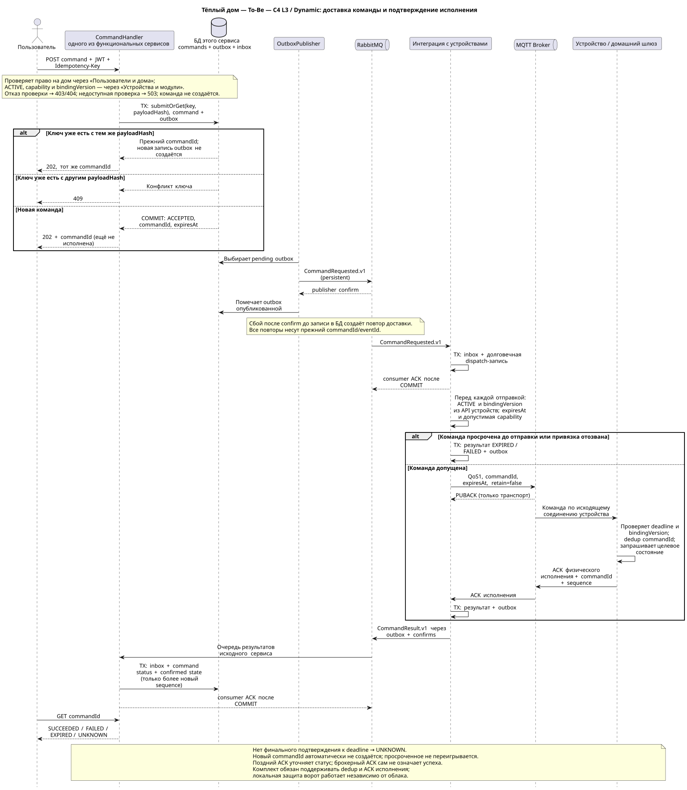

[Открыть SVG](docs/diagrams/to-be/c4-l3-dynamic-command-sequence.svg) · [Исходник PlantUML](docs/diagrams/to-be/c4-l3-dynamic-command-sequence.puml)

</details>

<details>
<summary>C4 L3 / Dynamic — последовательность: одноразовое подключение устройства и компенсация ошибки</summary>

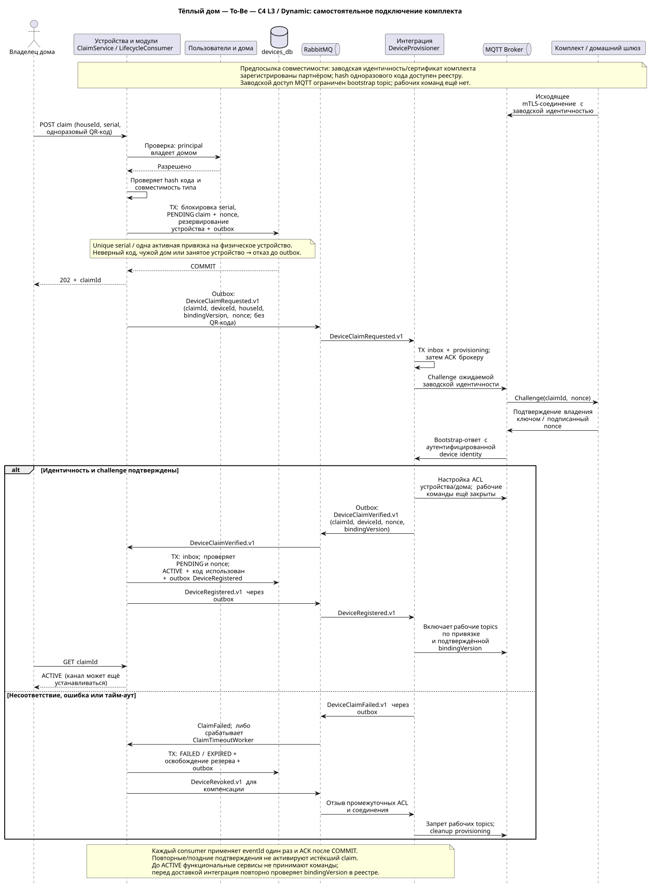

[Открыть SVG](docs/diagrams/to-be/c4-l3-dynamic-device-claim-sequence.svg) · [Исходник PlantUML](docs/diagrams/to-be/c4-l3-dynamic-device-claim-sequence.puml)

</details>

### Просмотр и повторная генерация

Структура исходников и SVG:

- `docs/diagrams/as-is/` — текущее решение;
- `docs/diagrams/to-be/` — целевое решение;
- `c4-l1-*` — контекст, `c4-l2-*` — контейнеры, `c4-l3-components-*` — компоненты;
- `c4-l3-dynamic-*` — динамическое взаимодействие компонентов, `c4-l4-code-*` — модель кода.

SVG включены в репозиторий. Единая команда повторно генерирует **все диаграммы As-Is и To-Be** из `docs/diagrams/as-is/` и `docs/diagrams/to-be/`. Из корня проекта выполните:

```bash
python3 tools/render_diagrams.py
```

Нужны Python 3 и Java. Скрипт находит полный JAR PlantUML в установленном плагине IntelliJ IDEA `intellij-omni-viewer`; для другого расположения задайте переменную `PLANTUML_JAR` фактическим путём к JAR со стандартной библиотекой C4. Java можно выбрать через `JAVA_BIN`. Интернет и Graphviz при генерации не используются.

Для PNG-превью всех диаграмм можно добавить `--png-dir /tmp/warmhouse-diagrams`. Исходники — [As-Is](docs/diagrams/as-is) и [To-Be](docs/diagrams/to-be), единый скрипт — [tools/render_diagrams.py](tools/render_diagrams.py). SVG сохраняются рядом с соответствующими `.puml`, PNG-превью — в указанной папке.

Нотация и семантика доставки сверены с первичными источниками: [C4](https://c4model.com/diagrams) и [динамические диаграммы C4](https://c4model.com/diagrams/dynamic), [RabbitMQ — Reliability Guide](https://www.rabbitmq.com/docs/reliability), [MQTT 5.0 — OASIS Standard](https://docs.oasis-open.org/mqtt/mqtt/v5.0/os/mqtt-v5.0-os.html). Транзакции и подтверждения сообщений: [Spring Framework — @Transactional](https://docs.spring.io/spring-framework/reference/data-access/transaction/declarative/annotations.html), [Spring AMQP — режимы ACK](https://docs.spring.io/spring-amqp/reference/amqp/containerAttributes.html). Выбор границ сервисов, контрактов и политик — проектное решение для этого задания.

# Задание 3. Разработка ER-диаграммы

### 1. Границы модели и обозначения

Логическая ER-модель уточняет данные To-Be системы из задания 2. Общий обзор и четыре детальных представления описывают одну модель с теми же владельцами данных; отдельная общая БД для всех сервисов не вводится. Атрибуты, ключи и обязательность полей приведены внутри сущностей на диаграммах.

- `PK` — первичный ключ, в том числе составной; `FK` — внешний ключ **внутри БД одного сервиса**; `UQ` — уникальность.
- `REF` — ссылка на идентификатор другого владельца данных. Она проверяется через его API или проекцию событий; межсервисного SQL FK нет.
- `*` перед атрибутом означает обязательное значение; поля без `*` допускают `NULL`. Кратности подписаны в легенде каждой диаграммы.
- Сплошная связь обозначает локальный FK, пунктирная — логическую межсервисную ссылку. Серые сущности на детальных представлениях — ссылки на данные владельца, а не новые локальные таблицы.
- `er-logical-*` в имени файла означает **логический уровень модели данных**. ER-диаграммы не обозначаются уровнями C4 L1–L4.

Для внутренних идентификаторов выбран `UUID`; `sub` пользователя — строковый идентификатор единственного настроенного OIDC IdP. Время хранится как `timestamptz`, в Java 21 ему соответствует `Instant`. `jsonb` используется для проверяемых по схеме возможностей, конфигурации, параметров команд и значений разных типов; ключевые связи и статусы остаются отдельными атрибутами.

### 2. Обзор ключевых сущностей

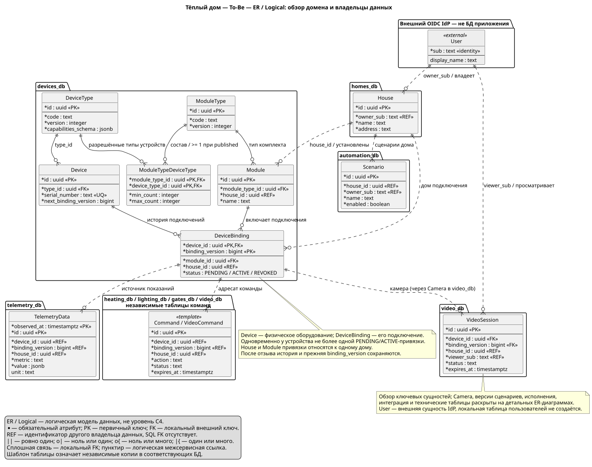

[Открыть SVG](docs/diagrams/to-be/er-logical-domain-overview.svg) · [Исходник PlantUML](docs/diagrams/to-be/er-logical-domain-overview.puml)

`User` показан как внешняя сущность IdP. В `homes_db` хранится `House.owner_sub`; локальные таблицы пользователей, паролей и токенов не добавляются. В MVP у дома один владелец, а у пользователя может быть несколько домов — это соответствует границам задания 2.

`ModuleType` — версия продаваемого комплекта, `Module` — его экземпляр в доме. `DeviceType` описывает совместимый тип физического оборудования и его возможности, `Device` — конкретный экземпляр с уникальной аппаратной идентичностью. Серийный номер нормализуется с префиксом партнёра, чтобы одинаковые заводские номера разных производителей не конфликтовали.

`DeviceBinding` связывает физическое устройство, установленный модуль и дом. До подключения у `Device` может не быть привязок. Текущая принадлежность определяется единственной `PENDING`/`ACTIVE`-привязкой, а завершённые подключения сохраняются с прежними версиями. Поэтому `house_id` не дублируется как независимый изменяемый атрибут самого `Device`. API устройства получает дом из привязки.

### 3. Детальные ER-представления

<details>
<summary>ER / Logical — дома, каталог комплектов и регистрация устройств</summary>

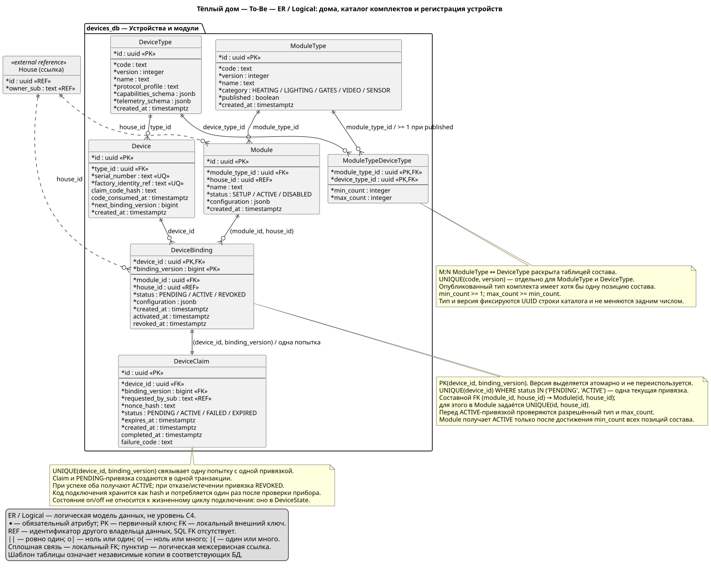

[Открыть SVG](docs/diagrams/to-be/er-logical-device-registry.svg) · [Исходник PlantUML](docs/diagrams/to-be/er-logical-device-registry.puml)

</details>

<details>
<summary>ER / Logical — команды, состояния, телеметрия и видеосессии</summary>

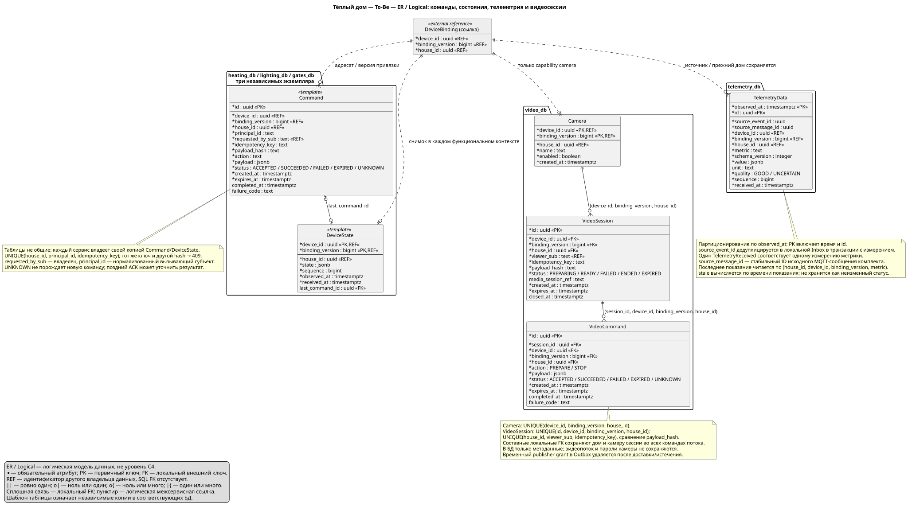

[Открыть SVG](docs/diagrams/to-be/er-logical-control-telemetry-video.svg) · [Исходник PlantUML](docs/diagrams/to-be/er-logical-control-telemetry-video.puml)

</details>

<details>
<summary>ER / Logical — версии сценариев, триггеры и исполнение действий</summary>

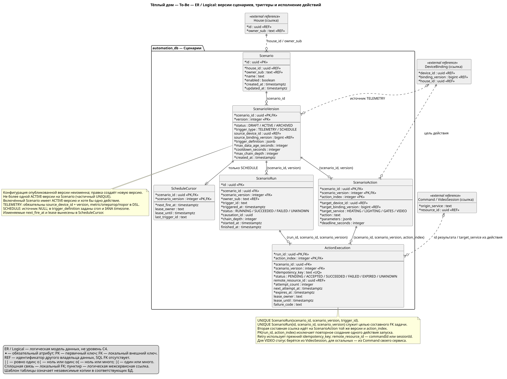

[Открыть SVG](docs/diagrams/to-be/er-logical-scenarios.svg) · [Исходник PlantUML](docs/diagrams/to-be/er-logical-scenarios.puml)

</details>

<details>
<summary>ER / Logical — интеграция с оборудованием и шаблоны Inbox/Outbox</summary>

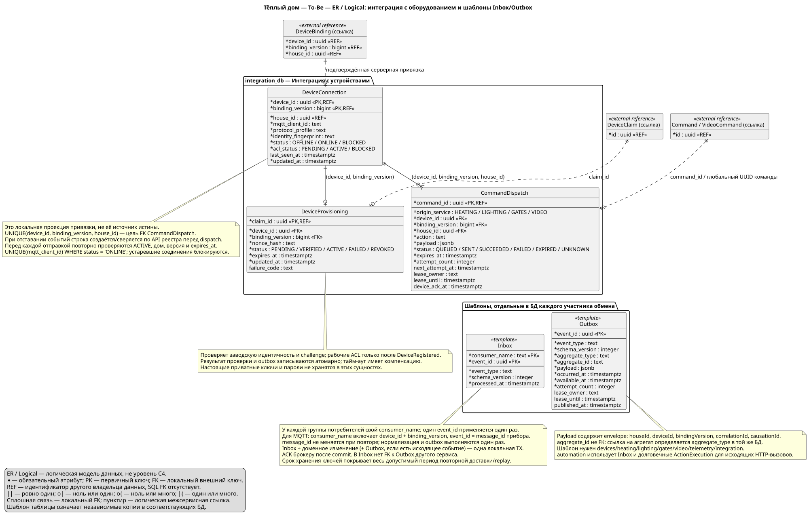

[Открыть SVG](docs/diagrams/to-be/er-logical-integration-messaging.svg) · [Исходник PlantUML](docs/diagrams/to-be/er-logical-integration-messaging.puml)

</details>

### 4. Владельцы данных

| Владелец | Сущности и ответственность |
| --- | --- |
| Внешний IdP | `User`: идентичность пользователя. В приложении используется его `sub`, а не копия учётных данных. |
| Пользователи и дома — `homes_db` | `House`: имя, адрес и `owner_sub`. Модель `House` раскрыта на обзорной диаграмме; серые `House` на остальных — ссылки. |
| Устройства и модули — `devices_db` | `ModuleType`, `ModuleTypeDeviceType`, `DeviceType`, `Module`, `Device`, `DeviceBinding`, `DeviceClaim`: каталог, состав комплектов, физическое оборудование, версии привязки и попытки подключения. |
| Отопление — `heating_db` | Собственные `Command` и `DeviceState`, только для возможностей отопления. |
| Освещение — `lighting_db` | Собственные `Command` и `DeviceState`, только для возможностей освещения. |
| Ворота — `gates_db` | Собственные `Command` и `DeviceState`, с раздельными состояниями открытия и запирания. |
| Видеонаблюдение — `video_db` | `Camera`, `VideoSession`, `VideoCommand`: профиль камеры, доступ к просмотру и команды подготовки/остановки потока. |
| Телеметрия — `telemetry_db` | `TelemetryData`: измерения с метрикой, единицей, временем, качеством и версией привязки. |
| Сценарии — `automation_db` | `Scenario`, `ScenarioVersion`, `ScenarioAction`, `ScheduleCursor`, `ScenarioRun`, `ActionExecution`: правила, расписания, запуски и долговечные задачи действий. |
| Интеграция с устройствами — `integration_db` | `DeviceConnection`, `DeviceProvisioning`, `CommandDispatch`: проекция соединений, проверка подключения и доставка команд оборудованию. |

`Inbox` и `Outbox` — шаблоны технических таблиц, которые создаются независимо в БД участников обмена. В `automation_db` исходящие HTTP-действия хранятся в `ActionExecution`, поэтому отдельная событийная `Outbox` этому сервису в текущей модели не нужна. В `homes_db` событийный обмен заданием 2 не предусмотрен. Все локальные изменения и связанные с ними записи сообщений выполняются транзакционно через Spring Framework.

### 5. Основные связи и ограничения целостности

| Связь | Кратность и смысл |
| --- | --- |
| `User` — `House` | `1 : 0..N`. У каждого дома ровно один владелец; пользователь может ещё не иметь домов. Связь логическая через `owner_sub`. |
| `House` — `Module` | `1 : 0..N`. Экземпляр комплекта установлен ровно в одном доме; это межсервисная ссылка. |
| `ModuleType` — `Module` | `1 : 0..N`. Каждый экземпляр фиксирует конкретную версию типа комплекта. |
| `ModuleType` — `DeviceType` | `M : N` через `ModuleTypeDeviceType`. Для опубликованного комплекта требуется хотя бы одна позиция; `min_count` и `max_count` задают состав. Привязка проверяет разрешённый тип и максимум устройств, а `Module` становится `ACTIVE` после достижения минимумов всех позиций. |
| `DeviceType` — `Device` | `1 : 0..N`. У физического устройства ровно один тип и версия каталога. |
| `Module` — `Device` | Через `DeviceBinding`: у модуля много устройств, а устройство одновременно связано не более чем с одним модулем. История позволяет последовательные подключения к разным модулям. |
| `DeviceBinding` — `TelemetryData` | `1 : 0..N`. Каждое измерение принадлежит устройству, дому и версии подключения, действовавшим при его получении. |
| `DeviceBinding` — `DeviceState` | `1 : 0..1` отдельно в каждом функциональном сервисе. Снимка ещё может не быть; позднее он обновляется по `sequence`. |
| `Camera` — `VideoSession` | `1 : 0..N`. Одна камера может иметь несколько сессий просмотра; каждая сессия относится к одной камере и дому. |
| `Scenario` — `ScenarioVersion` — `ScenarioAction` | На каждом шаге `1 : 0..N`; у включённого сценария обязательны активная версия и хотя бы одно действие. |
| `ScenarioVersion` — `ScenarioRun` — `ActionExecution` | На каждом шаге `1 : 0..N`; запуск закрепляет версию, а задача — конкретное действие этой же версии. |

Ключевые правила реализации:

1. **Подключение устройства.** `DeviceClaim` и `PENDING`-привязка создаются атомарно. Частичный уникальный индекс по `DeviceBinding.device_id` для статусов `PENDING`/`ACTIVE` исключает параллельное подключение устройства к двум домам. При успешной проверке код потребляется один раз; при отказе/истечении попытка завершается, а привязка отзывается. Для новой попытки выделяется новая `binding_version`. При повторном подключении после успешного использования нужен новый одноразовый код.
2. **Принадлежность дому.** В `devices_db` составной FK `(module_id, house_id)` ссылается на `Module(id, house_id)`, поэтому устройство нельзя привязать к модулю чужого дома. Между БД ссылка `(device_id, binding_version, house_id)` проверяется по API владельца или подтверждённой проекции. Отзыв привязки не меняет дом у старых измерений и команд.
3. **Статусы и идемпотентность.** `DeviceBinding.status` описывает подключение, `DeviceConnection.status` — доступность канала, `DeviceState.state` — физическое состояние, а `Command.status` — результат команды. Они не заменяют друг друга. Сочетание `(house_id, principal_id, idempotency_key)` уникально в каждом сервисе команд; другой payload с прежним ключом — конфликт. `SUCCEEDED` требует ACK исполнения, а отсутствие подтверждения даёт `UNKNOWN`, без автоматического создания новой команды.
4. **Телеметрия.** `TelemetryData` партиционируется по `observed_at`, поэтому первичный ключ включает `(observed_at, id)`. Дедупликация `source_event_id` выполняется через локальную `Inbox` в одной транзакции с измерением; один `TelemetryReceived` описывает одну метрику. Комплект передаёт стабильный `message_id`, одинаковый при повторе MQTT-доставки. Интеграция дедуплицирует его в своей `Inbox` с областью `(device_id, binding_version)`, поэтому повтор не создаёт новых нормализованных событий; исходный ID сохраняется как `source_message_id`. Индекс чтения начинается с `(house_id, device_id, binding_version, metric, observed_at)`. Показания проверяются по схеме и допустимому времени; `stale` вычисляется при чтении. `sequence` по контракту комплекта монотонен в пределах привязки, старое значение не заменяет новое.
5. **Сценарии.** Опубликованные условия и действия версии неизменны. Частичный уникальный индекс допускает не более одной `ACTIVE`-версии на сценарий. `UNIQUE(scenario_id, scenario_version, trigger_id)` защищает от повторного запуска по одному событию или моменту расписания. Составные FK `ActionExecution` к `ScenarioRun` и `ScenarioAction` исключают исполнение действия из другой версии. Ключ HTTP-повтора стабилен для `(run_id, action_index)`, а пользовательское право проверяется целевым сервисом при исполнении.
6. **Видео и история.** Сессия закрепляет зрителя, дом, камеру и срок действия; составные FK внутри `video_db` сохраняют эту принадлежность в командах потока. Видеопоток не хранится в PostgreSQL. Параметры `VideoCommand` содержат метаданные сессии; временный publisher grant для доставки шлюзу может находиться в `Outbox` и удаляется после доставки или истечения. Отзыв устройств и отключение сценариев не удаляют историю каскадом между сервисами; сроки хранения задаются отдельно. Ключи `Inbox` сохраняются не меньше допустимого периода replay/повторной доставки.

### 6. Рендеринг

Все ER-исходники и SVG находятся в `docs/diagrams/to-be/` и включены в общий скрипт вместе с C4-диаграммами As-Is и To-Be:

```bash
python3 tools/render_diagrams.py
```

Миграции БД и реализация сервисов в задание 3 не входят. Нотация: [PlantUML Information Engineering](https://plantuml.com/ie-diagram). Ограничения реализации сверены с документацией PostgreSQL: [ключи партиционированных таблиц](https://www.postgresql.org/docs/17/ddl-partitioning.html#DDL-PARTITIONING-DECLARATIVE-LIMITATIONS), [частичные уникальные индексы](https://www.postgresql.org/docs/15/sql-createindex.html).

# Задание 4. Создание и документирование API

### 1. Тип API

Укажите, какой тип API вы будете использовать для взаимодействия микросервисов. Объясните своё решение.

### 2. Документация API

Здесь приложите ссылки на документацию API для микросервисов, которые вы спроектировали в первой части проектной работы. Для документирования используйте Swagger/OpenAPI или AsyncAPI.

# Задание 5. Работа с docker и docker-compose

Перейдите в apps.

Там находится приложение-монолит для работы с датчиками температуры. В README.md описано как запустить решение.

Вам нужно:

1) сделать простое приложение temperature-api на любом удобном для вас языке программирования, которое при запросе /temperature?location= будет отдавать рандомное значение температуры.

Locations - название комнаты, sensorId - идентификатор названия комнаты

```
	// If no location is provided, use a default based on sensor ID
	if location == "" {
		switch sensorID {
		case "1":
			location = "Living Room"
		case "2":
			location = "Bedroom"
		case "3":
			location = "Kitchen"
		default:
			location = "Unknown"
		}
	}

	// If no sensor ID is provided, generate one based on location
	if sensorID == "" {
		switch location {
		case "Living Room":
			sensorID = "1"
		case "Bedroom":
			sensorID = "2"
		case "Kitchen":
			sensorID = "3"
		default:
			sensorID = "0"
		}
	}
```

2) Приложение следует упаковать в Docker и добавить в docker-compose. Порт по умолчанию должен быть 8081

3) Кроме того для smart_home приложения требуется база данных - добавьте в docker-compose файл настройки для запуска postgres с указанием скрипта инициализации ./smart_home/init.sql

Для проверки можно использовать Postman коллекцию smarthome-api.postman_collection.json и вызвать:

- Create Sensor
- Get All Sensors

Должно при каждом вызове отображаться разное значение температуры

Ревьюер будет проверять точно так же.


